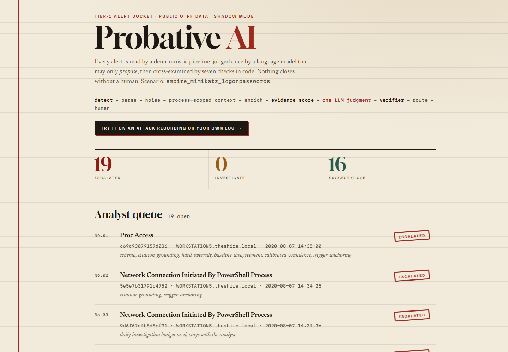
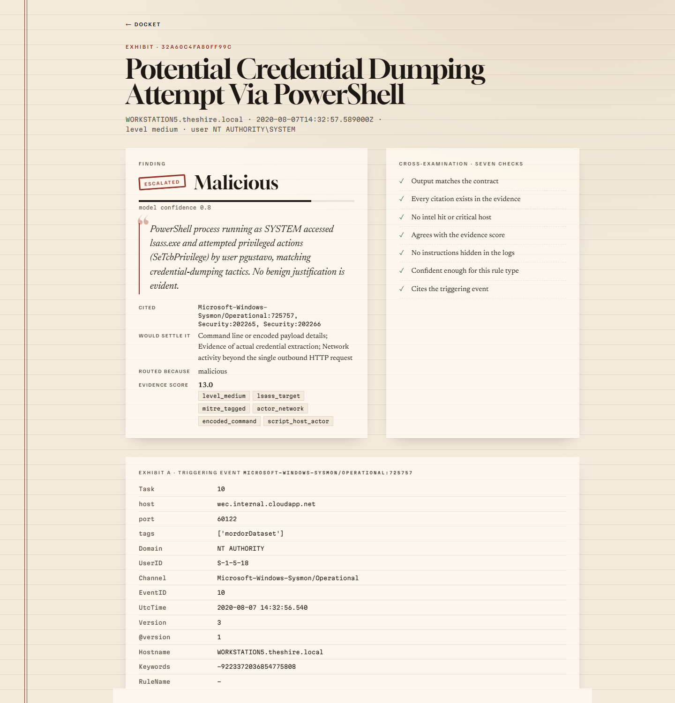
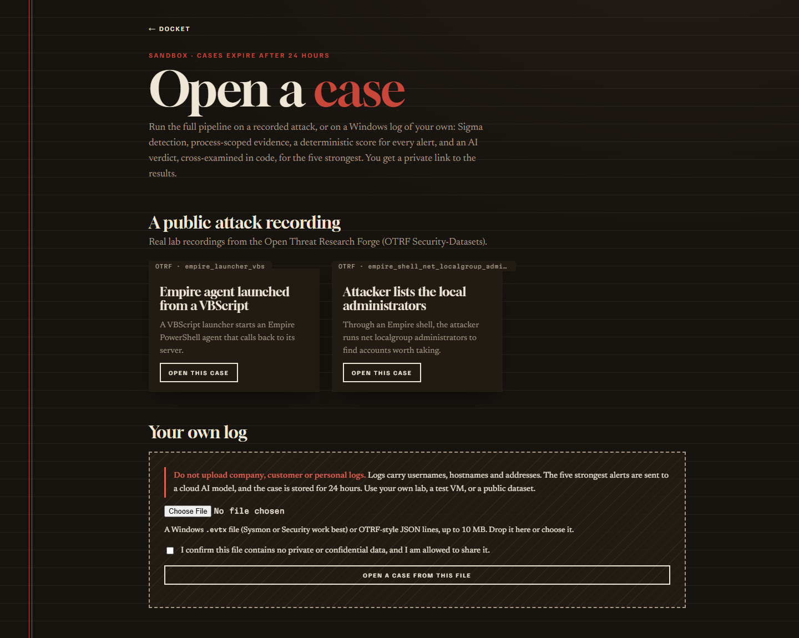

# Probative AI

Tier-1 SOC alert triage that is measured, not demoed: a deterministic pipeline with **one** LLM
judgment call, a code-owned verifier, and a human gate. The model proposes; code decides.

```
logs -> Sigma (Hayabusa) -> parse -> noise filter -> process-scoped context -> enrich
     -> evidence score (deterministic baseline) -> triage call (LLM, structured output only)
     -> verifier (7 checks) + router -> analyst queue | suggested close | investigate
```

Design: [`docs/design.md`](docs/design.md). Build log and gates: [`docs/build-prompts.md`](docs/build-prompts.md).



| An exhibit: verdict, testimony, the seven checks | The sandbox: open a case on a recorded attack or your own log |
| --- | --- |
|  |  |

## Results so far

OTRF `empire_mimikatz_logonpasswords` (public), 35 labelled alerts, shadow mode
([`eval/reports/20261031T121443Z.md`](eval/reports/20261031T121443Z.md)):

| Method | Recall on malicious | Closed | Malicious closed |
| --- | --- | --- | --- |
| LLM (`openai/gpt-oss-20b`) + verifier | 16/16 = 100% | 16/35 = 46% | 0 |
| Evidence score (deterministic) | 14/16 = 88% | 21/35 = 60% | 2 |
| Rule severity only | 0/16 = 0% | 35/35 = 100% | 16 |

Neither kill condition fired; the success bar (>= 50% closed at >= 95% recall) is narrowly not met.
Caveats: one lab scenario, 35 labels (30 Claude-proposed and human-reviewed), free-tier model limits.
See [`docs/baseline.md`](docs/baseline.md) and the report's caveats.

**The investigator** ([`eval/reports/investigator-20261101T102853Z.md`](eval/reports/investigator-20261101T102853Z.md)), on the
6 alerts the triage call left as suspicious: recall 6/6 like escalating straight to a human, but it closed none
and spent ~113k tokens, so on this data a human wins. The step logs say why: the process-scoped evidence already
held what its first query found, the host timeline returns thousands of noisy events, and there is no
threat-intel feed for lookups to hit. Next: cap events per query and connect a feed.

## Try it

Live: **https://probative-ai.onrender.com** (free tier: the first visit after ~15 idle minutes takes about a minute).

- **The docket** (`/`): the labelled OTRF alerts, routed and waiting for an analyst.
- **The sandbox** (`/try`): open a case from a public OTRF attack recording, or upload a Windows `.evtx` file or
  OTRF-style JSON lines (up to 10 MB). Hayabusa runs Sigma over it on the server; every alert gets the deterministic
  pipeline and evidence score; the 5 highest-scoring get an LLM verdict cross-examined by the verifier. The rest are
  marked "AI not run" and escalate (never shown as benign). You get a private link; the case is deleted after 24 hours.
- **Do not upload company, customer or personal logs.** For uploads, the uploader's "no private data" declaration is
  what tags the data `dataset=public` and so allows the cloud model. Limits: 3 cases per hour per visitor, 30 AI
  verdicts per day site-wide.

## The investigator

Alerts the triage call marks *suspicious, insufficient context* go to a bounded, read-only investigator:
`process_tree`, `network_connections`, `host_timeline` (at most 15 minutes) and `entity_lookup`, with every
argument checked in code and no free-text queries. It runs at most 6 steps, and each must add new evidence. It ends
in a verdict the same verifier accepts, or hands the alert to a human with its full step log, which the alert's
page shows. On the live site it investigates demo alerts only, at most 5 a day (free model budget).
`python -m eval.harness investigate --provider groq` compares it with escalating straight to a human.

## Architecture as deployed

- **Postgres (Neon)** holds events, alerts, verdicts, human decisions, rule modes and an append-only audit log.
- **A Postgres queue table** replaces Redis Streams: leased claims, acks, reclaim of expired leases, a priority lane.
- **One Render free web service** runs FastAPI and, as threads, the enrich and triage workers. They talk only
  through the queue, so each could become its own service with no code change. Scaling is processes on one
  host, not separate machines.
- **Shadow mode:** nothing is closed without a human. Accept/reject on a suggested close needs the demo token.

**Security note:** write endpoints use one static bearer token (`API_TOKEN`). That is demo-grade auth, not fit
for real data. The LLM is only ever sent alerts tagged `dataset=public`, and only with `ALLOW_CLOUD=true`.

## Run it locally

```bash
pip install -r requirements-dev.txt
cp .env.example .env        # fill in DATABASE_URL, TEST_DATABASE_URL, GROQ_* (see the comments)
pytest -q                   # unit tests, offline
pytest -q -m integration    # database tests against the Neon test branch
lint-imports                # module boundaries
uvicorn --factory triage.api.app:create_app --reload
```

Data (`data/`, gitignored) comes from `scripts/null_test/detect.py`, which runs Hayabusa over the OTRF scenario.

## Deploy (Render + Neon)

1. Create a Neon project; copy the main branch connection string.
2. Seed it with the labelled alerts, routed with the recorded results (no model calls):
   `python -m eval.harness seed --provider groq` (uses `DATABASE_URL` from `.env`).
3. On Render: New → Blueprint → this repo. Enter `DATABASE_URL` and `GROQ_API_KEY` when asked.
   `API_TOKEN` is generated; read it in the Render dashboard to accept or reject suggestions.

The free service sleeps after about 15 idle minutes; the first visit after that is slow while it wakes.

## Evaluate

```bash
python -m eval.harness baseline                  # deterministic baselines
python -m eval.harness run --provider groq       # full pipeline + LLM, writes eval/reports/<timestamp>.md
python -m eval.harness stack --provider groq     # replay the recorded run through Postgres + workers (Phase 4 gate)
```

## License

MIT, see [LICENSE](LICENSE). The OTRF datasets and Hayabusa rules keep their own licenses.
